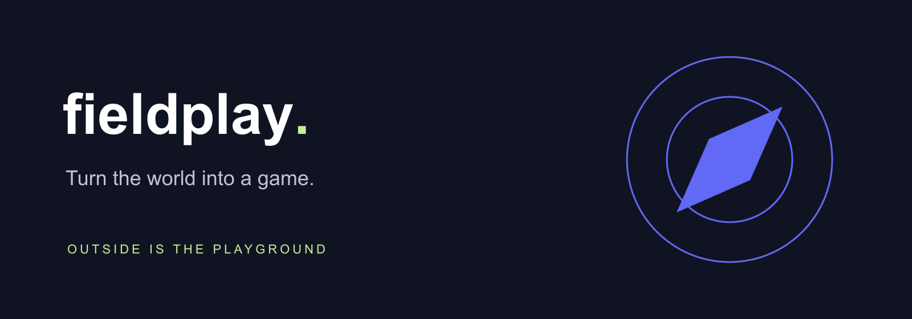
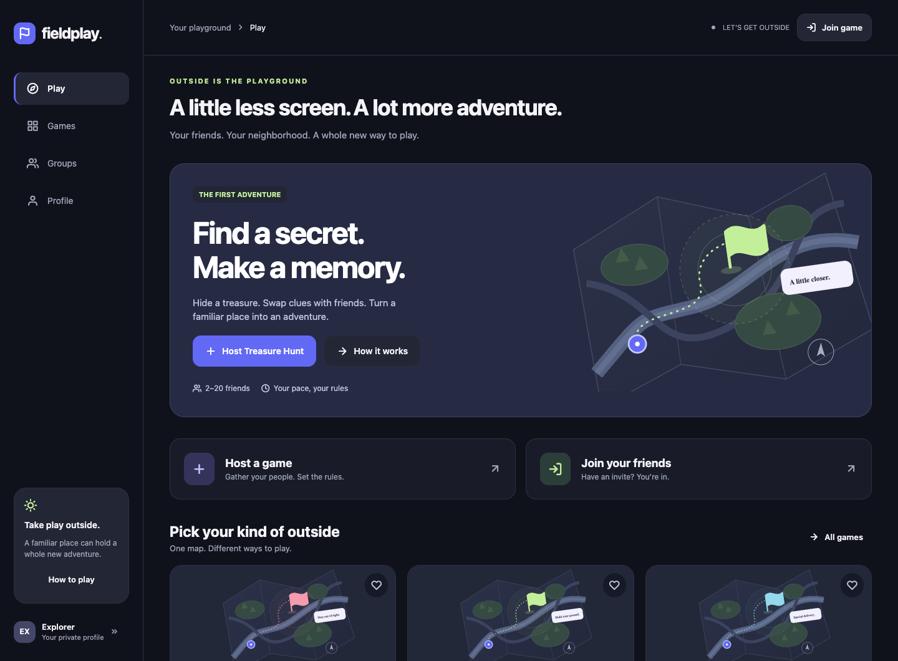

<p align="center"></p>

# Fieldplay

Private outdoor multiplayer adventures. **Your friends. Your field. Your rules.** An independent OpenRecode application, separate from Pathway.

**Private development build · AGPL-3.0-only · no public release.** Web multiplayer has executed end-to-end tests. iOS/Android source, native configuration and JavaScript bundles are prepared; compiled-device and outdoor behavior remain unverified. Fieldplay is a provisional name with a known unrelated App Store name collision.

## Play the world outside

- **Treasure Hunt:** hide a GPS treasure, swap secret clues, search contracting circles and verify a discovery.
- **Manhunt:** follow delayed pings, stay in a shrinking arena and confirm safe non-contact encounters.
- **Checkpoint Domination:** capture geographic checkpoints and earn team territory points.
- **Smugglers vs. Customs:** transport hidden virtual cargo, coordinate interceptions and score deliveries.

Private parties support scoped guests, code/link/QR invites, host/co-host controls, teams, readiness, chat, results and another round. The shared authority enforces rules and filters hidden information before transmitting it. Play over real WebRTC DataChannels or your own dedicated WebSocket authority. No proprietary game service is required; cross-network play may require your own TURN relay.

GPS sharing needs separate consent. Anyone can pause or withdraw. No permanent tracking, public player search, contact requirement, ads or subscriptions.

## Run privately

Requires **Node.js 24 and npm 11**:

```sh
npm ci
npm run server
```

In another terminal:

```sh
npm run dev
```

For a production web export: `npm run web:build`, then `npm run preview`. Configure `ws://localhost:8787` as the private server when preview and authority use separate ports. Native WebRTC/MapLibre require a custom development or release binary, not Expo Go.

The functional app is `/`; its distinct product landing is `/welcome/`. X-Center is the default hosting target; [private deployment instructions](docs/SELF_HOSTING.md) keep the service isolated and loopback-only. No public endpoint is activated.

## Real app preview



Actual web UI, not a native-device screenshot. The decorative map artwork does not depict tracked players.

## Develop and verify

```sh
npm run check
npm run web:build
npm run test:browser
```

The test suite includes real WebSocket games, a two-browser WebRTC Treasure Hunt, offline PWA behavior and file-based developer idea transfer. GPS observations in these tests are synthetic and isolated; they are not physical-device evidence.

| Platform / distribution | Status |
|---|---|
| Web / installable PWA | Production export and Chromium gameplay/offline tests |
| iOS / iPadOS | Shared native implementation; archive/device testing outstanding |
| Android | Shared native implementation and secure installer module; compilation/device installation outstanding |
| IPA / simulator bundle / universal APK / AAB | Parallel GitHub Actions jobs prepared; no published packages |

[Validation report](docs/reports/VALIDATION.md) · [Feature inventory and gaps](docs/FEATURES.md) · [Roadmap](docs/ROADMAP.md)

## Documentation

[Start here](docs/INDEX.md) · [Architecture](docs/ARCHITECTURE.md) · [Game rules](docs/features/GAMES.md) · [Networking](docs/SYNC.md) · [Security/privacy](docs/SECURITY.md) · [Development](docs/DEVELOPMENT.md) · [Builds/releases](docs/RELEASES.md) · [Ideas](docs/features/IDEAS.md) · [Branding](docs/BRANDING.md)

Development flows through `testing → beta → main`. [Contributing](CONTRIBUTING.md), [conduct](CODE_OF_CONDUCT.md), [security reporting](SECURITY.md) and [changelog](CHANGELOG.md) describe the project conventions. No publication or external store channel has authorization.

## License

Original code and branding © 2026 Fieldplay contributors, **AGPL-3.0-only**. [Complete license](LICENSE). Third-party software, native binaries, icon fonts and map datasets retain their own licenses; see [notices](THIRD_PARTY_NOTICES.md). Preserve map attribution and provide corresponding source to the authorized audience when distributing/hosting modified software. Wider distribution requires the remaining compatibility and licensing review.
